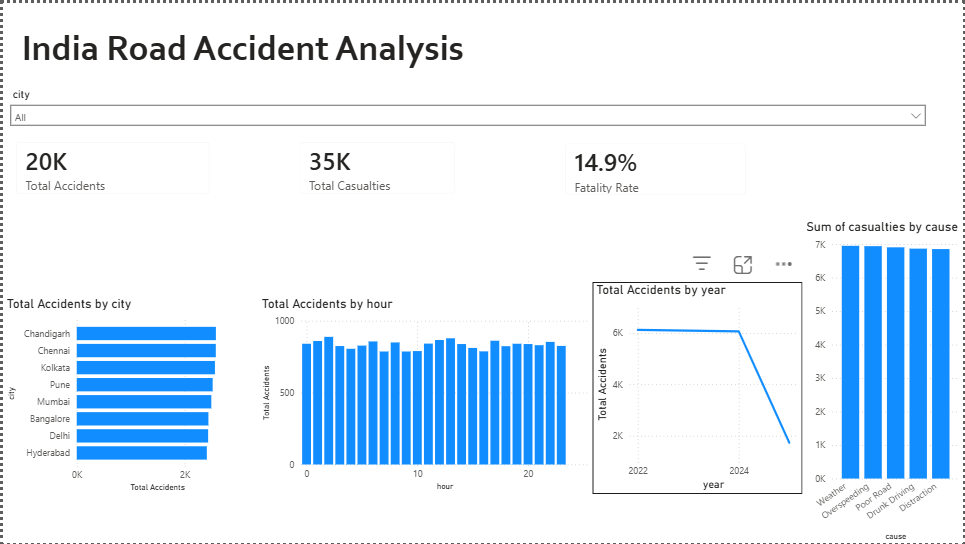

# Indian Road Accident Analysis (2022-2025)

## Problem Statement

Road accidents are a leading cause of death and injury in India. This project
analyses a dataset of **20,000** road accident records to uncover patterns
in accident timing, location, weather conditions, and causes -- with the goal of
identifying high-risk factors that could inform road-safety policies.

## Dataset Source

- **Kaggle**: [Indian Road Accident Dataset 2022-2025](https://www.kaggle.com/datasets/sehaj1104/indian-road-accident-dataset-2022-2025) by **sehaj1104**

> **Note**: This dataset appears to be **synthetic / simulated** data.
> Severity distributions are suspiciously uniform across cities, and several
> logical contradictions exist (e.g. weather = "Clear" but cause = "Weather").
> Therefore, findings are limited to this dataset and should **not** be treated
> as real-world conclusions.

## Tools Used

| Tool | Purpose |
|------|---------|
| Python 3 | Data cleaning & analysis |
| pandas | Data manipulation |
| matplotlib | Visualisations |
| SQLite | SQL-based analysis |
| Power BI | Interactive dashboard (DAX measures provided) |
| Git | Version control |

## Data Cleaning Steps

| Step | Detail |
|------|--------|
| Rows loaded | 20,000 |
| Duplicates removed | 0 |
| Bad dates (could not parse) | 0 |
| Rows dropped (missing date/city) | 0 |
| Rows after cleaning | 20,000 |
| Text columns | Stripped whitespace + Title Case |
| New columns added | `year`, `month`, `time_band`, `is_fatal` |

## 5 Key Insights

1. **Most Accident-Prone City**: Chandigarh with 2,577 accidents (highest volume among all cities).
2. **Peak Accident Hour**: 2:00 AM with 888 accidents. Safest hour: 7:00 AM with 786 accidents.
3. **Leading Cause of Casualties**: 'Weather' caused 6,953 casualties across 3,997 accidents.
4. **Overall Fatality Rate**: 14.9% — 2,987 fatal out of 20,000 total accidents.
5. **Fatality Rates Are Nearly Uniform (~15%)**: Across cities, weather conditions, and causes, fatality rates hover around 14–16% with no statistically meaningful variation. This strongly suggests the severity label was assigned randomly during data generation, making fatality-rate comparisons **not meaningful**.

## Data Quality Notes

These issues confirm the dataset is **synthetic / simulated**:

- **Uniform fatality rates**: Every city, weather type, and cause shows ~15% fatality rate — real-world data would show significant variation (e.g., fog being far deadlier than clear skies).
- **Weather = "Clear" but Cause = "Weather"**: 1,316 rows (6.6% of data). A clear contradiction — clear weather should not be the accident cause.
- **Minor severity but >3 casualties**: 1,174 rows. Minor accidents with many casualties are logically inconsistent.
- **Severity distribution across cities is suspiciously uniform**, consistent with randomly generated labels rather than real accident reporting.
- **No fatal accidents with 0 casualties** and **no vehicles = 0** — these basic sanity checks pass, but the uniformity issues above outweigh them.

> **Bottom line**: This dataset is useful for practising data-pipeline skills (SQL, Python, Power BI) but its findings should **not** be cited as real-world road-safety conclusions.

## Folder Structure

```
accident_risk_score/
|-- data/
|   |-- raw.csv            # Original dataset
|   +-- cleaned.csv        # Cleaned dataset (for Power BI)
|-- sql/
|   +-- queries.sql        # All 6 SQL queries
|-- outputs/
|   |-- city_fatality.csv
|   |-- hourly_accidents.csv
|   |-- weather_fatality.csv
|   |-- cause_casualties.csv
|   |-- state_ranking.csv
|   |-- yearly_trend.csv
|   +-- chart_*.png        # 5 matplotlib charts
|-- powerbi/
|   +-- dax_measures.txt   # DAX measures for Power BI
|-- notebooks/             # (for Jupyter exploration)
|-- docs/
|   +-- code_explanation.md
|-- run_all.py             # Main pipeline script
|-- requirements.txt
|-- .gitignore
+-- README.md
```

## How to Run

```bash
# 1. Create a virtual environment (optional but recommended)
python -m venv venv
venv\Scripts\activate        # Windows
# source venv/bin/activate    # Linux/Mac

# 2. Install dependencies
pip install -r requirements.txt

# 3. Run the pipeline
python run_all.py
```

This will clean the data, run SQL queries, generate charts, and create this README.

## Dashboard


